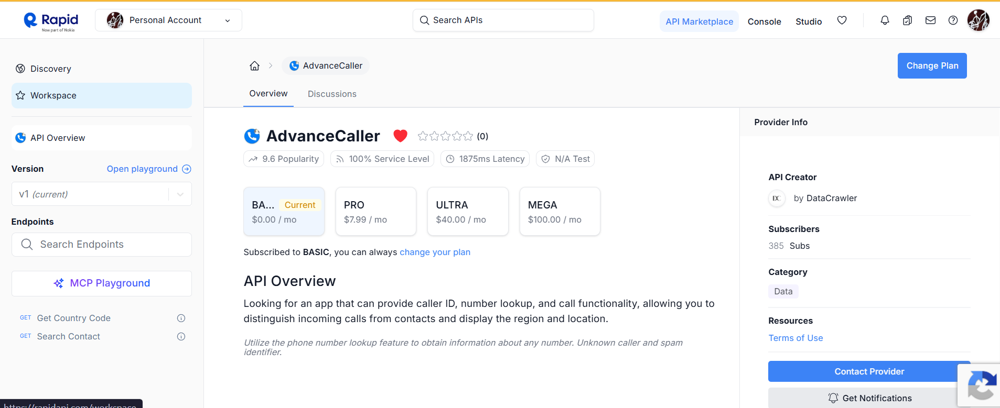
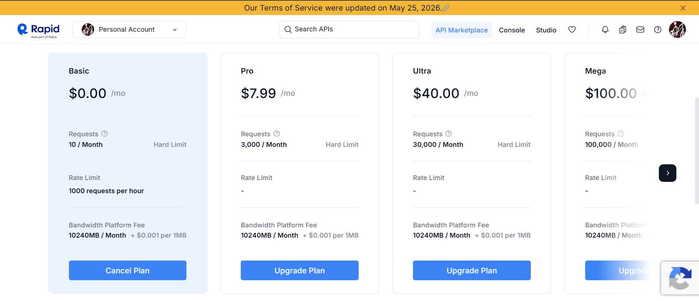

# AdvanceCaller-API
This api is provided via `RapidAPI-website`.

It provides two api endpoints.
* GET: country code
* GET: search contact 

## API Response:
``` json
{'status': True, 'message': 'Success', 'timestamp': 1781605734442, 'data': {'status': True, 'data': {'email': 'sachinsamhita@gmail.com', 'name': 'Sachin Jain'}}}
```
## About the API


## Pricing 

