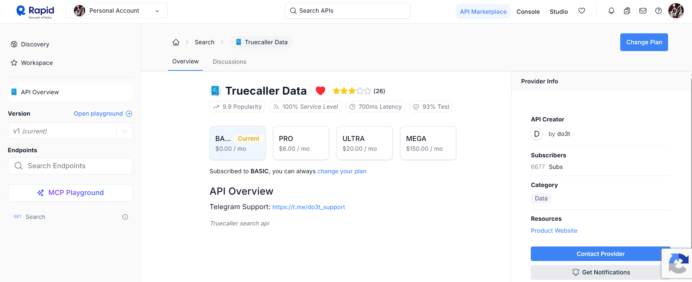
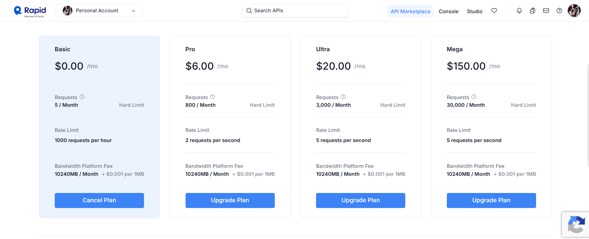

# TruecallerData-API
This api is provided via `RapidAPI-website`.

It provides two api endpoints.
* GET: country code
* GET: search contact 

## API Response(Example, as rate limit exeded for today)
```json
{
  "data": {
    "addressInfo": {
      "address": "",
      "street": "",
      "zipCode": "",
      "countryCode": "IN",
      "city": "Delhi",
      "timeZone": "+05:30"
    },
    "badges": [
      "verified_business"
    ],
    "basicInfo": {
      "about": "",
      "gender": "",
      "image": "https://business-priority-media-noneu.truecaller.com/production/logos/2e94d230-bf7c-4bb0-b4a6-c3d80a946f87-1698838507160464453.png",
      "jobTitle": "",
      "name": {
        "altName": "",
        "firstName": "",
        "fullName": "Maruti Suzuki India Limited",
        "lastName": ""
      }
    },
    "internetInfo": {},
    "phoneInfo": {
      "e164Format": "+919999999999",
      "numberType": "MOBILE",
      "nationalFormat": "099999 99999",
      "dialingCode": 91,
      "countryCode": "IN",
      "spamScore": 7026,
      "spamType": "TOP_SPAMMER",
      "carrier": "Vi",
      "type": "openPhone"
    },
    "score": 0.95,
    "searchWarnings": [],
    "spamInfo": {
      "spamScore": 7026,
      "spamType": "TOP_SPAMMER",
      "spamStats": {
        "numReports": 9445,
        "numReports60days": 860,
        "numSearches60days": 76261,
        "numCallsHourly": [
          0,
          0,
          0,
          0,
          0,
          0,
          0,
          0,
          0,
          0,
          1,
          0,
          1,
          1,
          2,
          2,
          6,
          4,
          1,
          0,
          1,
          0,
          1,
          1
        ],
        "numCalls60days": 1099,
        "numCallsNotAnswered": 806,
        "numCallsAnswered": 293,
        "numMessages60days": 13,
        "topSpammedCountries": [
          {
            "countryCode": "IN",
            "numCalls": 1097
          },
          {
            "countryCode": "",
            "numCalls": 2
          }
        ]
      }
    },
    "tags": [
      "Vehicle Service"
    ]
  },
  "error": 0
}
```
## About the API


## Pricing 
