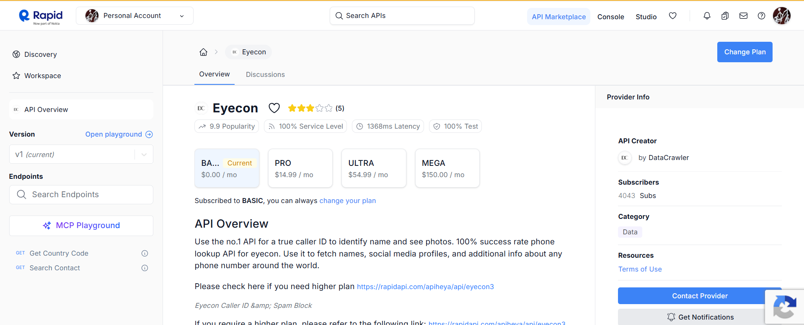
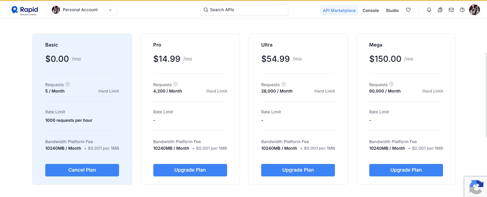

# AdvanceCaller-API
This api is provided via `RapidAPI-website`.

It provides two api endpoints.
* GET: get country code
* GET: search contact 

## API Response
``` json
{'status': True, 'message': 'Success', 'timestamp': 1781606816987, 'data': {'fullName': 'Shweta Kumari', 'otherNames': [{'name': 'Shweta Kumari', 'type': ''}], 'images': []}}
```
## About the API


## Pricing 
