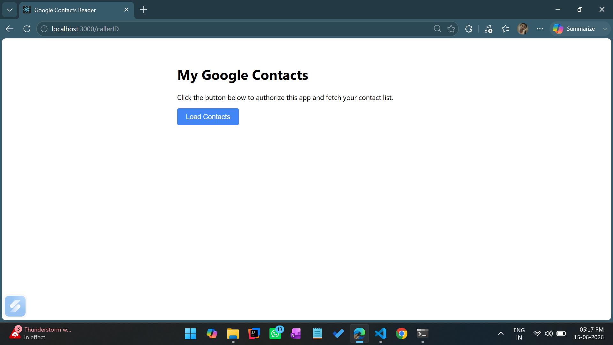
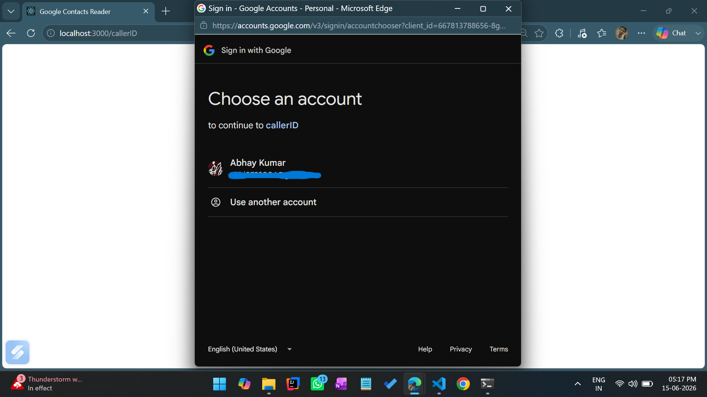
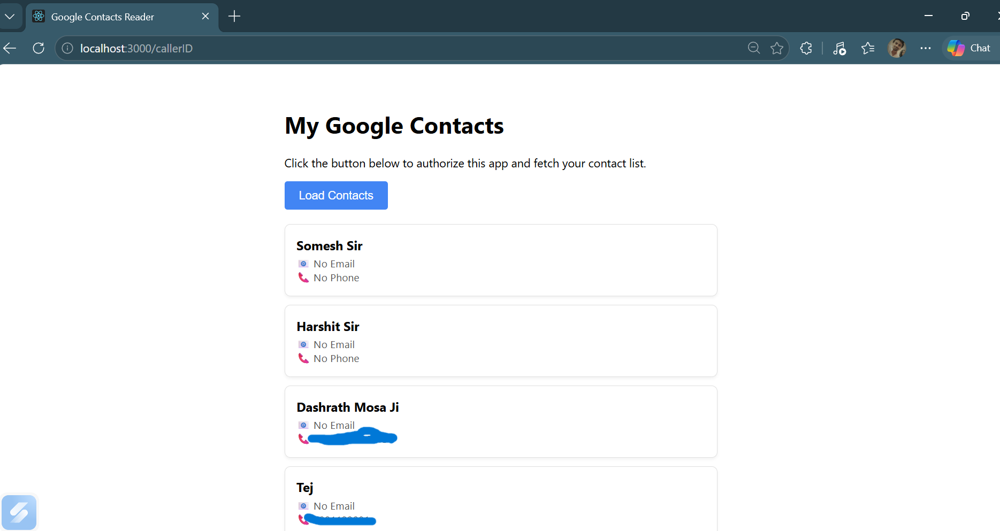

# Google People API.
Using this api we can `access` all the `google contacts` of the user, **only after user's consent**.

To use this api we have to `configure a project` on Google-Cloud.


## Steps to configure Google Cloud.
* **Step-1:** Create a Project on google cloud.
* **Step-2:** Go to `APIs & Services`--> `library`, then search and Add people API in your project.
* **Step-3:** Click on `Enable` and fill requied info accordingly.
* **Step-4:** Now, goto `APIs & Services`--> `Credentials` and click on `+create-credentials` to create a *OAuth 2.0 Client ID*. This Client-ID is your api key to access the people api project.
* **Step-5:** Now goto `APIs & Services`--> `OAuth consent screen` --> `Audience`. Scroll down and click on `+ Add users`. Then, add the emails at which you want to test this API. Only the provided emails have access to test this API until this Project is `Published`.

``` python 
#NOTE: The google cloud is configured. To  test it just initialize the below steps. 
```
## Run a localServer

### Node server:
* Ensure you have installed node in your system.By run `node -v` in Command promt. If it returns version like`v24.13.0`, then node is installed. If it return a `NotFound-Error` then install node first.
* Now run following commands to run node localserver.
```javascript 
    npm install serve
    npm serve
   ┌────────────────────────────────────────────┐
   │                                            │
   │   Serving!                                 │
   │                                            │
   │   - Local:    http://localhost:3000        │
   │   - Network:  http://192.168.31.186:3000   │
   │                                            │
   │   Copied local address to clipboard!       │
   │                                            │
   └────────────────────────────────────────────┘
```
* Now open this link:`http://localhost:3000 `in your browser and navigate to folder which contain `index.html`-file as provided.

<span style="color:white; background-color:gray; border-radius:4px; padding:2px "> NOTE:</span> Ensure to save `index.html` in your `C/-drive` in a folder with `config.js` which contain `CLIENT_ID`-secret-key. 

## Go through the program 
Screenshot preview




